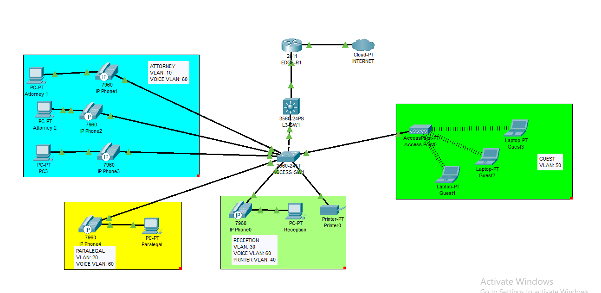

# Small Law Firm Network — Design, Implementation & Documentation

**Platform:** Cisco Packet Tracer  
**Project type:** Independent network design and implementation project  
**Status:** Implemented and tested in a simulated environment

## Project Overview

This project implements a segmented network for a small law office. The network supports attorneys, paralegal staff, reception, an office printer, guest wireless users, IP telephony, and network-device management.

The design uses a Cisco Catalyst 2960 access switch for Layer 2 connectivity and a multilayer switch for VLAN gateway interfaces, inter-VLAN routing, DHCP, and guest access control. A Cisco 2811 router provides the routed connection to the multilayer switch and hosts Cisco Call Manager Express (CME) for IP phone registration.

> This is an independently developed Cisco Packet Tracer project. It is presented as simulated practical work, not as a commercial production deployment.

## Topology

The topology diagram below shows the office endpoint groups, access switch, multilayer switch, edge router, and simulated Internet cloud.

## Project Objectives

- Separate departments and service types using VLANs.
- Provide DHCP addressing to client and voice networks.
- Enable inter-VLAN routing using a multilayer switch.
- Restrict guest access to internal networks using an ACL.
- Enable encrypted remote management using SSH.
- Provide IP telephony through CME and extensions.
- Test, troubleshoot, and document the implemented network.

## Network Architecture

| Device | Role |
|---|---|
| ACCESS-SW1 | Cisco Catalyst 2960 Layer 2 access switch for end devices |
| L3-SW1 | Multilayer switch providing SVIs, inter-VLAN routing, DHCP, and guest ACL enforcement |
| EDGE-R1 | Cisco 2811 router providing the routed connection and hosting CME |
| Cisco 7960 IP phones | Five configured phone endpoints/extensions |
| Wireless access point | Guest wireless access connected to VLAN 50 |
| Office printer | Printer endpoint with a statically assigned IPv4 address |

### VLAN and IP Addressing Plan

| VLAN | Name | Subnet | Default gateway |
|---:|---|---|---|
| 10 | ATTORNEYS | 192.168.10.0/24 | 192.168.10.1 |
| 20 | PARALEGAL | 192.168.20.0/24 | 192.168.20.1 |
| 30 | RECEPTION | 192.168.30.0/24 | 192.168.30.1 |
| 40 | PRINTER | 192.168.40.0/24 | 192.168.40.1 |
| 50 | GUEST-WIFI | 192.168.50.0/24 | 192.168.50.1 |
| 60 | VOICE | 192.168.60.0/24 | 192.168.60.1 |
| 99 | MANAGEMENT | 192.168.99.0/24 | 192.168.99.1 |

Additional addresses documented for the project:

| Device / interface | Address |
|---|---|
| ACCESS-SW1 VLAN 99 SVI | 192.168.99.2/24 |
| L3-SW1 Gi0/1 | 10.0.0.2/30 |
| EDGE-R1 Fa0/1 | 10.0.0.1/30 |
| Office printer | 192.168.40.10/24 (static) |

## Technologies and Configuration

- **VLAN segmentation:** Department, guest, voice, printer, and management traffic are separated into VLANs.
- **Voice and data VLANs:** User-facing switch ports carry a departmental data VLAN and voice VLAN 60 for connected IP phones.
- **802.1Q trunking:** ACCESS-SW1 and L3-SW1 are connected by a trunk carrying VLANs 10, 20, 30, 40, 50, 60, and 99.
- **Inter-VLAN routing:** L3-SW1 uses SVIs as VLAN default gateways and routes between VLANs.
- **DHCP:** L3-SW1 provides DHCP pools for Attorneys, Paralegal, Reception, Guest Wi-Fi, and Voice. The voice pool uses Option 150 pointing to 10.0.0.1.
- **Static printer addressing:** The office printer uses 192.168.40.10/24 with gateway 192.168.40.1; the documented configuration does not use a DHCP pool for the printer VLAN.
- **Guest access control:** The `GUEST_RESTRICTIONS` extended ACL is applied inbound on VLAN 50. It denies guest-originated traffic to 192.168.0.0/16 while permitting other destinations, subject to routing.
- **IP telephony:** EDGE-R1 hosts CME. Five Cisco 7960 phones register using extensions 1001–1005.
- **Static routing:** L3-SW1 has a default route toward EDGE-R1; EDGE-R1 has a return route toward the internal 192.168.0.0/16 address space.
- **Secure management:** SSH version 2 with local authentication is configured on ACCESS-SW1 and L3-SW1.

## Verification Results

The project documentation records the following test outcomes:

| Test | Recorded result |
|---|---|
| Office PC DHCP | Successful |
| Guest DHCP after ACL adjustment | Successful |
| IP phone DHCP | Successful |
| IP phone registration with CME | Successful |
| Attorney PC to Paralegal gateway (192.168.20.1) | Successful |
| Guest laptop to Attorney gateway (192.168.10.1) | Blocked / unreachable, consistent with the ACL |
| SSH to ACCESS-SW1 (192.168.99.2) | Successful |
| PC and phone operation after port-security removal | Successful |
| Sticky MAC learning on a standard access port | Successful |

## Troubleshooting and Lessons Learned

- Guest DHCP initially failed because the ACL did not permit the DHCP request. Adding `permit udp any any eq bootps` allowed guest DHCP to succeed. The documentation notes that this broad permit should be reviewed and refined in a future security review.
- Port security with sticky learning on phone/PC ports caused Secure-shutdown violations in the Packet Tracer project. Removing port security from Fa0/1–Fa0/5 restored PC DHCP and IP phone registration. Sticky MAC learning was successful on a standard PC access port.
- The project reinforced the importance of checking ACL direction, rule order, implicit deny behavior, and the packet path when troubleshooting.
- Configuration changes were tested and verified incrementally.

## Known Limitations

- Internet access was **not verified** in the documented tests. The presence of an Internet cloud in the topology should not be interpreted as proof of working Internet connectivity.
- Port security was not retained on the phone/PC access ports because of the observed simulator behavior described above.
- The guest DHCP permit is broad and is identified in the documentation as an item for future refinement.

## Project Files

- `diagrams/law-office-network-topology.png` — Packet Tracer topology image.
- `documentation/law-office-network-documentation.docx` — Detailed technical documentation supplied for this project.

## Disclaimer

This project was independently designed, configured, tested, and documented in Cisco Packet Tracer. Results describe the simulated implementation and the tests recorded in the accompanying documentation.
