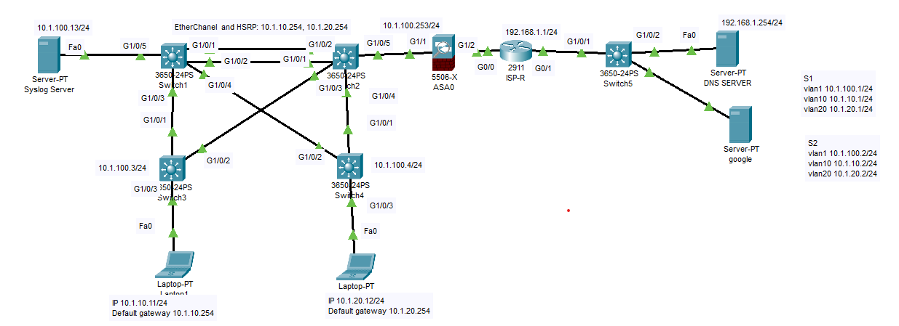

# Enterprise Network — Design, Implementation & Security

**Platform:** Cisco Packet Tracer  
**Project type:** Independent network design and implementation project

## Overview
This project documents a hierarchical enterprise network with an access layer, redundant distribution layer, and perimeter connection to a simulated external network.

The topology includes two distribution multilayer switches (S1 and S2), two access switches (S3 and S4), an ASA 5506-X firewall, an ISP 2911 router, an external Layer 2 switch (S5), a Syslog server, an external DNS/DHCP server, a simulated Google server, and two user laptops.

## Topology

## Technologies documented
- VLAN segmentation and multilayer switching
- LACP EtherChannel
- Rapid PVST+
- HSRP gateway redundancy
- OSPF dynamic routing
- Cisco ASA firewall and ACL filtering
- NAT/PAT
- Syslog and SNMP monitoring scope
- DNS and DHCP services

## Important implementation finding
The documentation records that ASA dynamic NAT was configured but did not translate traffic as expected in this Packet Tracer project, while PAT on the ISP router worked. This is a simulator-specific observation, not a general limitation of physical ASA firewalls.

## Project files
- `diagrams/enterprise-network-topology.png` — topology image recovered from Appendix C of the technical document.
- `documentation/enterprise-network-documentation.docx` — recovered technical documentation, including configuration appendices and verification commands.

## Disclaimer
This is an independently developed simulated project in Cisco Packet Tracer, not a commercial production deployment. Verification procedures are distinguished from test results where captured outputs were not available.
