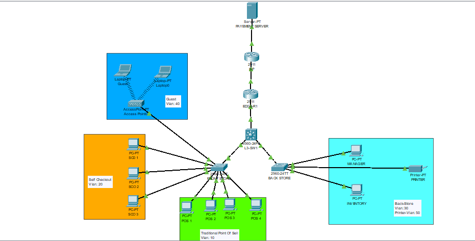

# Retail Store Network – Design & Implementation

**Platform:** Cisco Packet Tracer  
**Project Type:** Network Design, Implementation and Security

## 1. Project Overview

This project demonstrates the design and implementation of a retail store network supporting front-store checkout operations, self-checkout terminals, guest wireless connectivity, back-office operations, network printing, and external payment processing.

The network was designed with separate VLANs to isolate different business operations, improve network organization, and implement access control between network segments.

The infrastructure uses Cisco Catalyst switches, a multilayer switch, edge and ISP routers, and a wireless access point.

## 2. Network Topology

The following diagram illustrates the network architecture, including front-store operations, back-store infrastructure, guest wireless connectivity, and external payment server connectivity.

## 3. Network Architecture

The network is divided into the following operational areas:

**Front Store**
- Traditional Point-of-Sale (POS) terminals.
- Self-checkout terminals.
- Guest wireless access point.
- FRONT-STORE Cisco Catalyst 2960 switch.

**Back Store**
- Manager workstation.
- Inventory workstation.
- Network printer.
- BACK-STORE Cisco Catalyst 2960 switch.

**Network Infrastructure**
- L3-SW1 Cisco Catalyst 3560 multilayer switch.
- EDGE-R1 Cisco 2911 router.
- ISP-R1 Cisco 2911 router.
- External payment server.

## 4. VLAN and IP Addressing

| VLAN | Name / Purpose | Network | Default Gateway |
|---|---|---|---|
| 10 | Point of Sale | 192.168.10.0/24 | 192.168.10.1 |
| 20 | Self Checkout | 192.168.20.0/24 | 192.168.20.1 |
| 30 | Back Office | 192.168.30.0/24 | 192.168.30.1 |
| 40 | Guest Wi-Fi | 192.168.40.0/24 | 192.168.40.1 |
| 50 | Printers | 192.168.50.0/24 | 192.168.50.1 |
| 99 | Network Management | 192.168.99.0/24 | 192.168.99.1 |
| 999 | Unused Port VLAN | No IP address | N/A |

### Additional IP Addresses

| Device | IP Address |
|---|---|
| Network Printer | 192.168.50.10 (Static) |
| L3-SW1 | 10.0.0.2/30 |
| EDGE-R1 Internal Interface | 10.0.0.1/30 |
| EDGE-R1 External Interface | 203.0.113.2/24 |
| ISP-R1 Transit Interface | 203.0.113.1/24 |
| ISP-R1 Payment Server Interface | 198.51.100.1/30 |
| External Payment Server | 198.51.100.2/30 |

## 5. Technologies Implemented

**Routing and Switching**
- VLAN Configuration and Network Segmentation.
- Layer 2 Switching.
- 802.1Q Trunking.
- Inter-VLAN Routing.
- Static Routing.
- Default Route Configuration.

**Network Services**
- DHCP Configuration.
- DNS Configuration.
- NAT/PAT.
- Network Printer Configuration.
- External Payment Server Connectivity.

**Network Security**
- Extended Access Control Lists (ACLs).
- Guest Network Isolation.
- Switch Port Security with Sticky MAC Learning.
- PortFast.
- BPDU Guard.
- SSH Version 2.
- Unused Port Shutdown.
- Dedicated Management VLAN.

## 6. Network Security Implementation

Network segmentation was implemented to separate POS, self-checkout, back-office, guest wireless, printer, and management traffic.

An extended ACL named `GUEST-RESTRICTIONS` was configured inbound on VLAN 40.

The ACL implements the following policies:

- Permits DHCP client requests.
- Blocks guest-originated traffic toward internal networks within 192.168.0.0/16.
- Permits guest traffic to other destinations.

Additional security configurations include:

- Sticky MAC address learning on POS and self-checkout access ports.
- PortFast and BPDU Guard on selected endpoint-facing ports.
- Assignment of unused switch ports to VLAN 999.
- Administrative shutdown of unused switch ports.
- SSH Version 2 for secure remote device management.

## 7. External Payment Server Connectivity

An external payment server was connected to the ISP-side network to simulate an external payment processing service.

**Payment Server Details:**

- IP Address: `198.51.100.2`
- Subnet Mask: `255.255.255.252`
- Default Gateway: `198.51.100.1`

EDGE-R1 performs NAT/PAT for internal client networks, allowing multiple internal devices to share the external interface address when communicating with external networks.

The documented traffic path is:

`Client → Access Switch → L3-SW1 → EDGE-R1 → ISP-R1 → Payment Server`

NAT/PAT on EDGE-R1 was documented as functioning in the Packet Tracer implementation.

## 8. Network Testing and Verification

The technical documentation includes a verification checklist covering:

- VLAN creation and port assignments.
- Trunk configuration.
- Inter-VLAN connectivity.
- DHCP address assignment.
- Guest network access restrictions.
- Routing table verification.
- NAT/PAT translation.
- External payment server connectivity.
- SSH remote management.

The documentation distinguishes verification procedures from confirmed test results.

## 9. Technical Documentation

The complete technical documentation provides detailed information about:

- Network architecture and design.
- Device inventory and roles.
- IP addressing and VLAN segmentation.
- Switch and router configurations.
- DHCP implementation.
- Guest network ACL configuration.
- NAT/PAT implementation.
- External payment server connectivity.
- Network security implementation.
- Troubleshooting and verification procedures.

**[View or Download the Complete Technical Documentation](./documentation/retail-store-network-documentation.docx)**

## 10. Project Files

| File | Description |
|---|---|
| `README.md` | Project overview and technical summary |
| `diagrams/retail-network-topology.png` | Network topology diagram |
| `documentation/retail-store-network-documentation.docx` | Complete technical documentation |

## Disclaimer

This project was independently designed, configured, and documented using Cisco Packet Tracer. It represents practical networking experience gained through an independent simulated implementation and is not presented as a commercial production deployment.
